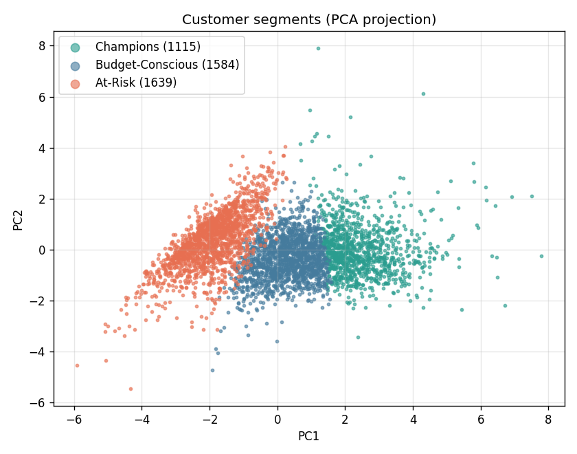
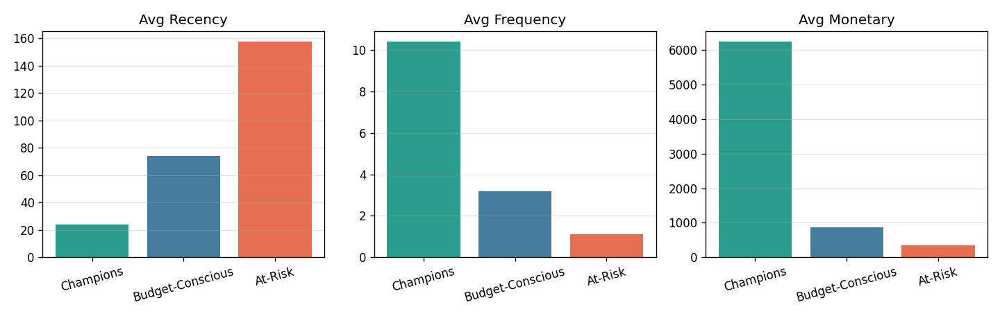
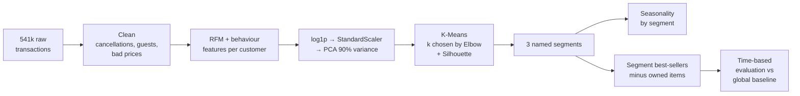

# 🛍️ Customer Segmentation & Recommender System

[](https://github.com/<your-username>/customer-segmentation-recommender/actions/workflows/ci.yml)


Segments **4,300+ retail customers** into three behavioural groups using **RFM feature engineering, PCA and K-Means**,
analyses each group's **seasonality**, and recommends **segment-specific best-sellers** the customer hasn't bought yet to drive cross-sell.
Includes an interactive **Streamlit dashboard** and a time-based evaluation of the recommender.

<p align="center">
  
  
</p>

> 📊 **Full results:** [`reports/RESULTS.md`](reports/RESULTS.md) — regenerated automatically on every `python train.py` run.
> 🌐 **Live demo:** _coming soon (Streamlit Community Cloud)_

---

## Problem

A UK online retailer has a year of transactions but treats every customer the same.
**Goal:** find distinct customer groups, understand when each group buys, and recommend the right products to each group to improve personalisation, retention and cross-selling.

## Approach



| Step | What happens | Why |
|---|---|---|
| **Cleaning** | Drop missing `CustomerID`, cancelled invoices (`C…`), non-positive quantity/price, duplicates | Keep only real, attributable purchases |
| **RFM features** | Recency, Frequency, Monetary + AvgOrderValue, UniqueProducts, Tenure | Turn transactions into one behaviour profile per customer |
| **log1p + scaling** | Compress skewed spend/frequency, standardise to mean 0 / std 1 | K-Means uses distances; outliers and units would dominate otherwise |
| **PCA** | Keep components explaining 90 % of variance (≥ 3 for 3D plots) | Removes correlated, redundant signal → cleaner separation |
| **K-Means** | Evaluate k = 2…10 with **WCSS / Elbow** and **Silhouette**, fit k = 3 | Three groups that are well-separated *and* actionable |
| **Naming** | Rank clusters by Frequency + Monetary − Recency | Stable business labels regardless of random cluster IDs |
| **Seasonality** | Monthly revenue and a seasonality index per segment | Tells marketing *when* to target each group |
| **Recommender** | Segment-specific ranking of best-sellers, excluding items the customer already owns | Targeted cross-sell |
| **Evaluation** | Train before 2011-09-01, test on later purchases; compare with one global best-seller list | Evidence that segment targeting is more accurate |

## Segments and strategy

| Segment | Behaviour | Recommendation strategy |
|---|---|---|
| **A · Champions** | Recent, frequent, high spend | Premium / high-value items (ranked by revenue) |
| **B · Budget-Conscious** | Moderate activity, smaller baskets | Value items below median price (ranked by units sold) |
| **C · At-Risk** | Long time since last order, low activity | Broadly popular items to re-engage (ranked by number of buyers) |

Exact sizes, averages and revenue share are in [`reports/RESULTS.md`](reports/RESULTS.md).

## Dataset

[**Online Retail** — UCI Machine Learning Repository](https://archive.ics.uci.edu/dataset/352/online+retail) (Chen, 2015, CC BY 4.0).
541,909 transactions from a UK-based online gift retailer, 1 Dec 2010 – 9 Dec 2011.

The raw file is **not** stored in this repo. Download it with `python scripts/download_data.py`.
No internet? `python scripts/make_synthetic_data.py` creates practice data with the same columns.

## Quickstart

```bash
git clone https://github.com/<your-username>/customer-segmentation-recommender.git
cd customer-segmentation-recommender

python -m venv .venv
# Windows: .venv\Scripts\activate     Mac/Linux: source .venv/bin/activate
pip install -r requirements.txt

python scripts/download_data.py   # get the data (~23 MB)
python train.py                   # run the full pipeline (1–3 min)
streamlit run app.py              # open the dashboard at http://localhost:8501
```

Other commands:

```bash
pip install -r requirements-dev.txt
pytest -q                                     # unit tests
jupyter notebook notebooks/01_walkthrough.ipynb   # step-by-step notebook
python train.py --skip-eval                   # faster run without the recommender evaluation
```

## Dashboard

`streamlit run app.py` opens five pages:

1. **Overview** — key metrics, segment profiles, strategy per segment, evaluation results
2. **Clusters (3D)** — rotatable PCA scatter plot + Elbow/Silhouette charts
3. **Seasonality** — monthly revenue and seasonality index by segment
4. **Recommend: existing customer** — pick a CustomerID → segment, RFM score, top-10 products
5. **Recommend: new customer** — enter behaviour → saved scaler + PCA + K-Means assign a segment → recommendations

The app reads only the small files in `artifacts/`, so it runs without the raw dataset.

## Project structure

```
customer-segmentation-recommender/
├── app.py                     # Streamlit dashboard
├── train.py                   # end-to-end pipeline
├── src/
│   ├── config.py              # paths and settings
│   ├── data_loader.py         # load + clean transactions
│   ├── features.py            # RFM feature engineering
│   ├── clustering.py          # scaling, PCA, K-Means, k evaluation, segment naming
│   ├── seasonality.py         # monthly / seasonal analysis
│   ├── recommender.py         # segment best-sellers, recommendations, evaluation
│   └── visualize.py           # Plotly (interactive) + Matplotlib (static) charts
├── scripts/
│   ├── download_data.py       # fetch UCI dataset
│   └── make_synthetic_data.py # offline practice data
├── notebooks/01_walkthrough.ipynb
├── tests/test_pipeline.py
├── artifacts/                 # trained models + output tables (created by train.py)
├── reports/
│   ├── RESULTS.md             # auto-generated results
│   └── figures/               # .png (README) and .html (interactive) charts
├── docs/STEP_BY_STEP.md       # build guide: how this project was made, step by step
├── data/raw/                  # dataset goes here (git-ignored)
├── requirements.txt
└── .github/workflows/ci.yml   # tests + pipeline on every push
```

## Tech stack

Python · pandas · NumPy · scikit-learn (StandardScaler, PCA, KMeans, silhouette_score) · Plotly · Matplotlib · Streamlit · joblib · pytest · GitHub Actions

## Future work

- Market-basket rules (Apriori / FP-Growth) for "frequently bought together" suggestions
- Collaborative filtering for individual-level recommendations
- Margin data to rank truly high-margin products for Champions
- Compare K-Means with Gaussian Mixture Models / hierarchical clustering
- Scheduled monthly retraining as customer behaviour shifts

## Author

**Your Name** — [GitHub](https://github.com/<your-username>) · [LinkedIn](https://linkedin.com/in/<your-profile>)

## License

Code: [MIT](LICENSE). Dataset: Daqing Chen, *Online Retail*, UCI Machine Learning Repository, 2015 — CC BY 4.0.
