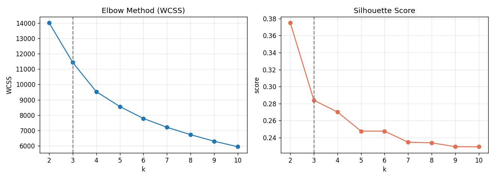
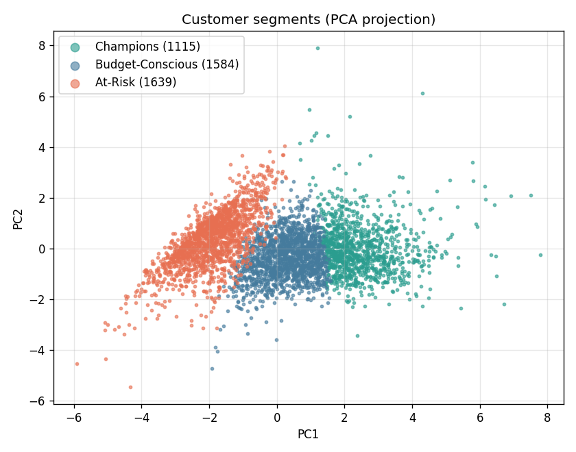
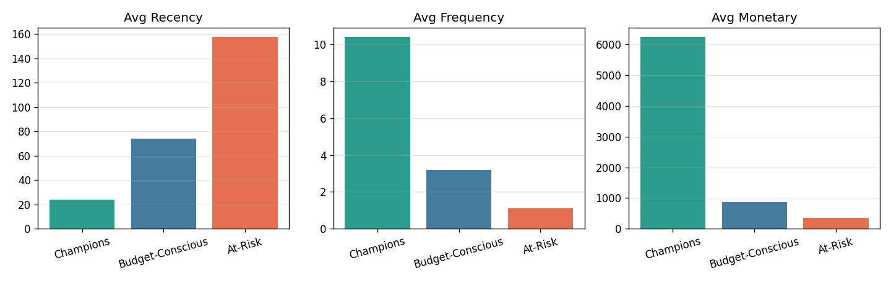
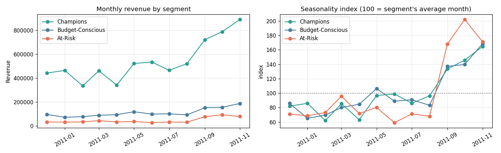

# Results

_Auto-generated by `train.py`. Data: 2010-12-01 to 2011-12-09, 392,692 clean transactions, 4,338 customers, 3,665 products._

## Model

| Item | Value |
|---|---|
| Features | Recency, Frequency, Monetary, AvgOrderValue, UniqueProducts, Tenure |
| PCA | 4 components, 95.9% variance kept |
| Clusters (k) | 3 (elbow at k=4, best silhouette at k=2) |
| Silhouette score | 0.284 |

## Segments

| Segment   | SegmentName      |   Customers |   Recency |   Frequency |   Monetary |   AvgOrderValue |   UniqueProducts |   Tenure | ShareOfCustomers   | ShareOfRevenue   |
|:----------|:-----------------|------------:|----------:|------------:|-----------:|----------------:|-----------------:|---------:|:-------------------|:-----------------|
| A         | Champions        |        1115 |      23.8 |        10.4 |    6,235.8 |           736.2 |            143.2 |    268.7 | 25.7%              | 78.2%            |
| B         | Budget-Conscious |        1584 |      73.8 |         3.2 |      863.3 |           285.7 |             46.1 |    165.3 | 36.5%              | 15.4%            |
| C         | At-Risk          |        1639 |     157.3 |         1.1 |      345.9 |           328.4 |             20.8 |      2.7 | 37.8%              | 6.4%             |

## Seasonality

| Segment   | SegmentName      | PeakMonth   |   PeakRevenue | Q4RevenueShare   |
|:----------|:-----------------|:------------|--------------:|:-----------------|
| A         | Champions        | Nov 2011    |       889,637 | 32.7%            |
| B         | Budget-Conscious | Nov 2011    |       187,756 | 32.8%            |
| C         | At-Risk          | Oct 2011    |        93,131 | 37.0%            |

## Top 5 recommended products per segment

**A · Champions** (Premium / high-value items)

|   Rank | StockCode   | Description                        |   UnitPrice |
|-------:|:------------|:-----------------------------------|------------:|
|      1 | 23843       | PAPER CRAFT , LITTLE BIRDIE        |        2.08 |
|      2 | 22423       | REGENCY CAKESTAND 3 TIER           |       12.75 |
|      3 | 85123A      | WHITE HANGING HEART T-LIGHT HOLDER |        2.95 |
|      4 | 23166       | MEDIUM CERAMIC TOP STORAGE JAR     |        1.25 |
|      5 | 85099B      | JUMBO BAG RED RETROSPOT            |        2.08 |

**B · Budget-Conscious** (Value items (below median price))

|   Rank |   StockCode | Description                         |   UnitPrice |
|-------:|------------:|:------------------------------------|------------:|
|      1 |       16014 | SMALL CHINESE STYLE SCISSOR         |        0.42 |
|      2 |       84077 | WORLD WAR 2 GLIDERS ASSTD DESIGNS   |        0.29 |
|      3 |       84879 | ASSORTED COLOUR BIRD ORNAMENT       |        1.69 |
|      4 |       18007 | ESSENTIAL BALM 3.5G TIN IN ENVELOPE |        0.18 |
|      5 |       84946 | ANTIQUE SILVER T-LIGHT GLASS        |        1.25 |

**C · At-Risk** (Popular re-engagement items)

|   Rank | StockCode   | Description                        |   UnitPrice |
|-------:|:------------|:-----------------------------------|------------:|
|      1 | 85123A      | WHITE HANGING HEART T-LIGHT HOLDER |        2.95 |
|      2 | 22423       | REGENCY CAKESTAND 3 TIER           |       12.75 |
|      3 | 22138       | BAKING SET 9 PIECE RETROSPOT       |        4.95 |
|      4 | 84879       | ASSORTED COLOUR BIRD ORNAMENT      |        1.69 |
|      5 | 21034       | REX CASH+CARRY JUMBO SHOPPER       |        0.95 |

## Recommender evaluation (time-based holdout)

Segments and product lists built on purchases before **2011-09-01**; scored on what 1,887 returning customers bought afterwards (only products new to each customer count).

| Metric (top 10) | Segment-based | Global best-sellers | 
|---|---|---|
| Hit rate | 27.5% | 25.9% |
| Precision | 3.8% | 3.4% |

Relative precision lift vs baseline: **+10.6%**
